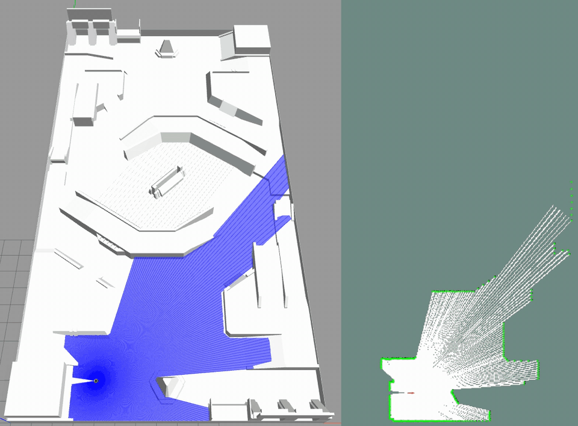
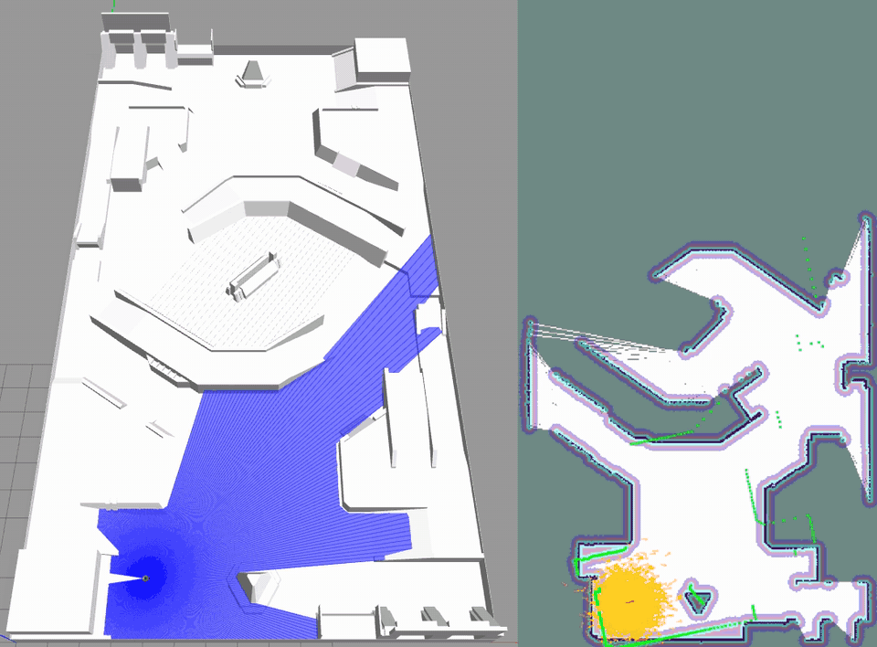
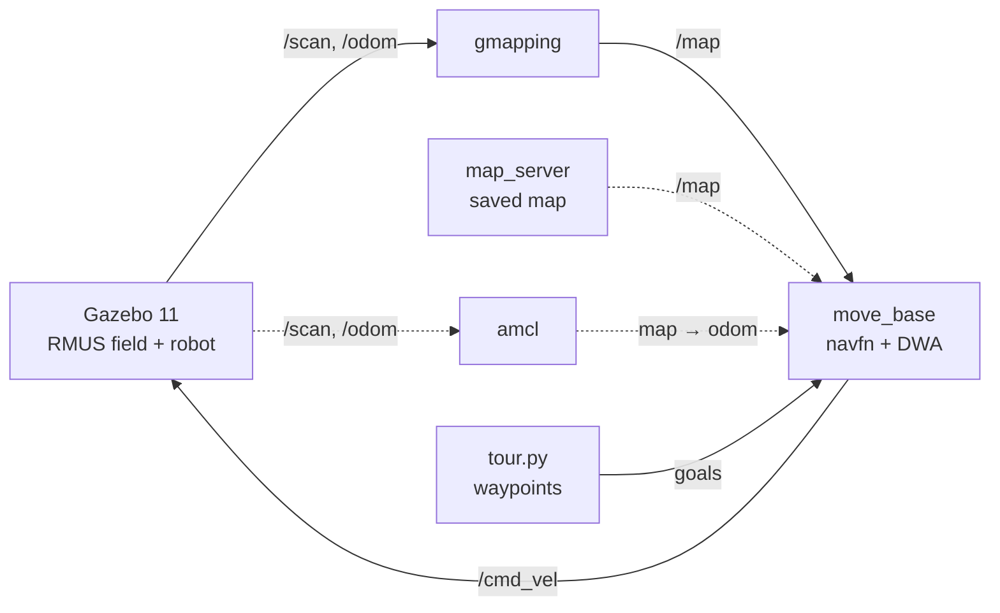

<div align="center">

# ROS 1: SLAM and Autonomous Navigation

**A two-wheel lidar robot maps the RMUS 2023 competition field from scratch, then localises
itself on that map and drives to goals on its own. Gazebo and RViz, one Docker command, runs
on an Apple-silicon Mac.**




<sub>Left: Gazebo, the whole field. The blue fan is the robot's lidar. Right: the map gmapping
builds as the robot drives a six-waypoint route and returns to its start (green: current scan
and plan, red arrows: path so far). 8× speed · <a href="docs/media/rmus_mapping.mp4">MP4</a></sub>

</div>

---

The robot starts in a corner of a 15 × 28 m field it has never seen, with nothing but wheel
odometry and a 2D lidar. gmapping turns the scans into an occupancy map while `move_base`
drives it from waypoint to waypoint, planning through space the map has not seen yet. The map
is then saved, and a second run starts the robot with a deliberately wrong guess of where it
is: AMCL works out the true pose from the lidar and `move_base` takes it to three goals across
the field.

This is my ROS 1 workspace from 2022, rebuilt for ROS Noetic and packaged so that anyone can
run it without installing ROS.

<table>
<tr>
<td align="center" width="33%"><h2>15 × 28 m</h2>RMUS 2023 competition field, from a CAD export to a Gazebo world the robot can drive in</td>
<td align="center" width="33%"><h2>9 / 9</h2>goals reached with no human input: six while mapping from scratch, three with AMCL on the saved map</td>
<td align="center" width="33%"><h2>1 command</h2>opens the full simulation in your browser. No ROS install, no Linux machine</td>
</tr>
</table>

## Navigating on the saved map



<sub>Yellow arrows are AMCL's particles. The robot was told it starts 0.4 m and 11° away from
where it really is, so the cloud starts wide and collapses onto the true pose within the first
metres; the green scan snaps onto the walls as it does. Purple: the inflated costmap the
planner keeps clear of. 8× speed · <a href="docs/media/rmus_navigation.mp4">MP4</a></sub>

AMCL is a particle filter too, but over poses on a fixed map rather than over maps. Each
particle is a guess of where the robot is; particles whose predicted scan matches the real one
survive resampling. GitHub CI re-runs this three-goal drive on every push.

## How it works



<sub>Solid: the mapping run. Dotted: navigation on the saved map.</sub>

| Layer | Packages | What it does |
|---|---|---|
| Robot | `urdf02_gazebo` | two-wheel differential-drive car in xacro: 0.2 m chassis on casters, 2D lidar (360 beams, 5.5 Hz, 30 m range), camera mount; Gazebo diff-drive and laser plugins |
| World | `rmus_map` | the field as a static mesh: walls up to 2.5 m, a central platform 9 cm up with two 8° ramps |
| Mapping | `gmapping` | Rao-Blackwellized particle filter: 30 particles, each with its own trajectory and 5 cm occupancy grid |
| Localisation | `amcl` | Monte Carlo localisation on the saved map, 500 to 5000 particles, likelihood-field laser model |
| Planning and control | `move_base`, `navfn`, `dwa_local_planner` | Dijkstra path on the costmap; DWA samples (v, ω) pairs, simulates each for 1.5 s and keeps the one that best follows the path while staying clear of obstacles |
| Mission | `nav-demo/scripts/tour.py` | sends waypoints to `move_base` one after another |

**Why the routes stay on the floor.** The platform in the middle is ringed by 9 cm steps and
covered in small bumps. The lidar sits 37 cm up and sees neither, so a planner working from
its map would happily send the robot off a ledge. Both routes therefore keep to the floor of
the lower half and the right-hand corridor, and the lidar maps whatever it can see from there.

## Second robot: an Ackermann racecar

`racecar_ws` is a car-like robot on a runway lined with cones. `move_base` plans on a saved
map, the TEB local planner shapes a trajectory that respects the car's minimum turning
radius, and a pure-pursuit node turns it into steering and speed. Given one goal 23 m away, it
comes to rest 0.24 m from it; CI repeats that drive on every push as well.

```bash
docker run --rm -p 6080:6080 ros1-racecar desktop.sh roslaunch racecar_gazebo racecar_runway_demo.launch
```

## Quick start

### Docker (any OS, including Apple silicon)

```bash
git clone https://github.com/InvalidCodes/2022ROS1.git && cd 2022ROS1
docker build -t ros1-racecar -f docker/Dockerfile .      # about 6 GB
```

Watch it live in the browser:

```bash
docker run --rm -p 6080:6080 ros1-racecar desktop.sh
```

Open <http://localhost:6080/vnc.html>, click **Connect**, and pick a target in the field with
RViz's **2D Nav Goal** tool. The robot plans a path and drives there.

Record the demos above headlessly, or run the end-to-end checks that CI runs:

```bash
docker run --rm -v "$PWD/out:/out" ros1-racecar record_demo.sh rmus_mapping
docker run --rm -v "$PWD/out:/out" ros1-racecar record_demo.sh rmus_navigation
docker run --rm ros1-racecar test_navigation.sh rmus        # or: racecar
```

On an Apple-silicon Mac the image runs natively on arm64 and Gazebo renders on the CPU. With
[Colima](https://github.com/abiosoft/colima) (6 CPUs, 12 GB) the simulation runs at about
0.95× real time.

### Native (Ubuntu 20.04 + ROS Noetic)

```bash
cd ws_rviz
rosdep install --from-paths src --ignore-src -r -y
catkin build && source devel/setup.bash

roslaunch nav-demo rmus_slam.launch     # Gazebo + gmapping + move_base
rosrun nav-demo tour.py                 # second terminal: drive the mapping route

roslaunch nav-demo rmus_nav.launch      # or: AMCL + move_base on the saved map
rviz -d ../docker/rviz/rmus_navigation.rviz
```

## Repository layout

```
ws_rviz/                       the RMUS demos and the ROS 1 exercises they grew out of
  src/
    nav-demo/                  SLAM and navigation: launch files, move_base config, saved map, tour.py
    urdf02_gazebo/             the two-wheel car in xacro with camera, lidar and diff-drive plugins
    rmus_map/                  the RMUS 2023 field: CAD mesh, URDF, Gazebo worlds
    urdf01_rviz/               first URDF robots in RViz: links, joints, xacro
racecar_ws/                    the Ackermann racecar
  src/racecar/
    racecar_description/       URDF/xacro, meshes
    racecar_gazebo/            worlds, saved maps, launch files, navigation config, path_pursuit.py
    racecar_control/           ros_control config, teleop
    system/                    ackermann_cmd_mux, VESC and serial drivers, waypoint logger
docker/                        image, browser desktop, headless recording, end-to-end tests
docs/media/                    the animations in this README
```

<details>
<summary><b>Porting notes: from Kinetic-era code to Noetic on arm64</b></summary>

| Problem | Fix |
|---|---|
| The robot spun its wheels without moving: the field's floor is a 10 cm slab and the robot was spawned inside it | spawn on top of the slab |
| The casters dragged on the ramps and stalled the robot | frictionless casters in `car_lidar.xacro` |
| `car.xacro` includes the field's URDF, which defines a second `base_link`; the original world also has a car saved inside it | `car_lidar.xacro` is the car alone, and `rmus_field.world` holds the field as a static model |
| RMUS world meshes pointed at `/home/...` on the original machine | `model://` URIs resolved through the package |
| `racecar_gazebo` did not configure: OpenCV listed as a catkin component, a hard-coded OpenCV 3 path and a misspelled `${OpenCV_LiBRARIES}` | find OpenCV as a system package |
| `findLine.cpp` includes `<opencv/highgui.h>`, which OpenCV 4 removed | `<opencv2/highgui.hpp>` |
| Python 2 nodes: mixed tabs and spaces, `print` statements, `Tkinter`, `python` shebangs | ported to Python 3 |
| Gazebo hung for minutes on the runway: its 8 cones load from Gazebo's retired online model database | the image fetches `construction_cone` from the model repository and turns the database off |
| The racecar's gmapping never produced a map: the simulation publishes the ground-truth pose as `map → base_link`, so there is no `odom` frame | gmapping uses `map` as its odometry frame and publishes `slam_map → map` |
| `path_pursuit.py` ignored every goal after the first | it drives again when a new goal arrives |
| ROS 1 has no macOS or arm64-Mac install | Docker image, Xvfb + software OpenGL for rendering, noVNC for interactive use |

</details>

## Acknowledgements and license

The racecar simulation under `racecar_ws/src/racecar` is adapted from the open-source
[MIT RACECAR](https://github.com/mit-racecar) stack and its community extensions (MuSHR
teleop, the Yujin Robot command mux, VESC and serial drivers). Those files keep their original
licenses. Everything else is MIT, see [LICENSE](LICENSE).

See also [2022ROS2](https://github.com/InvalidCodes/2022ROS2), the ROS 2 counterpart.
