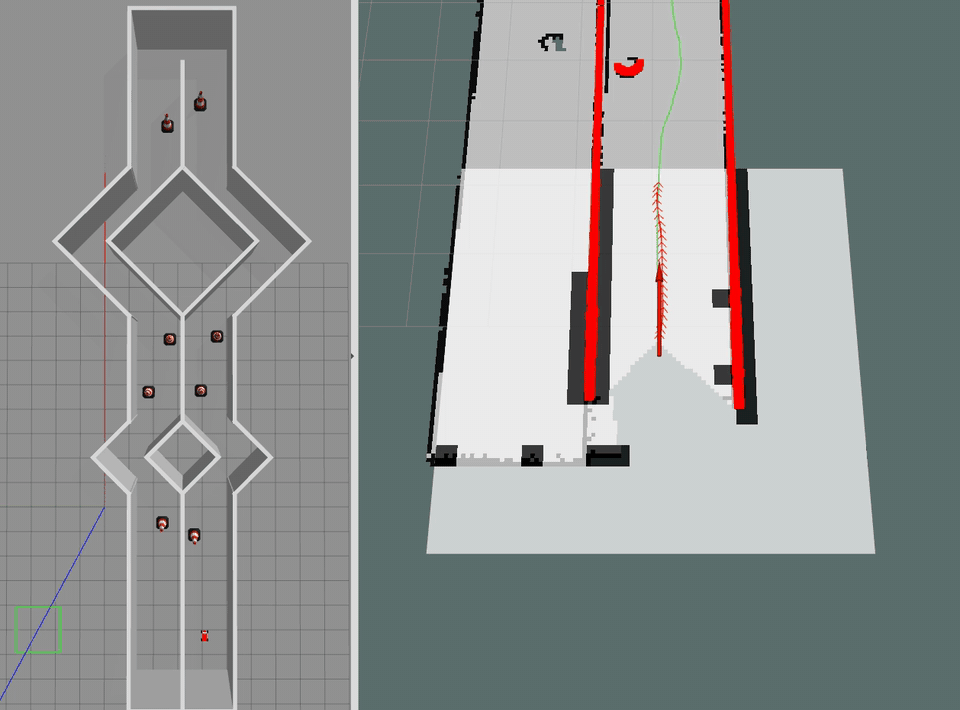
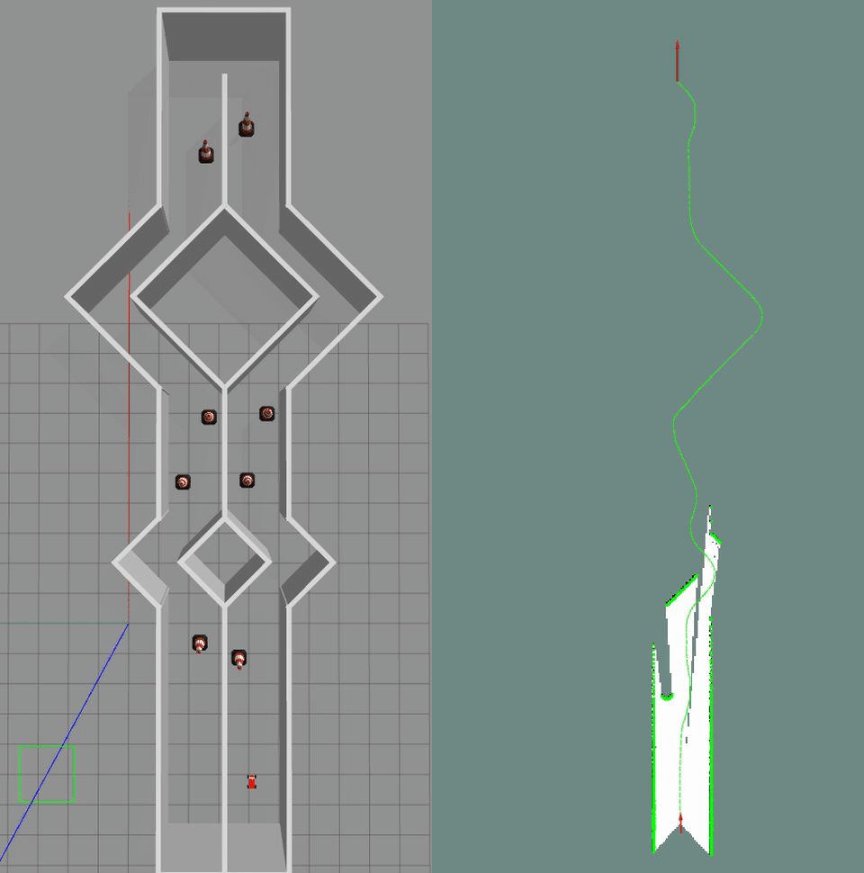
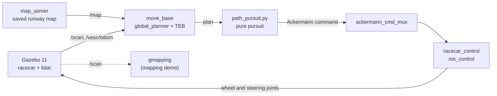
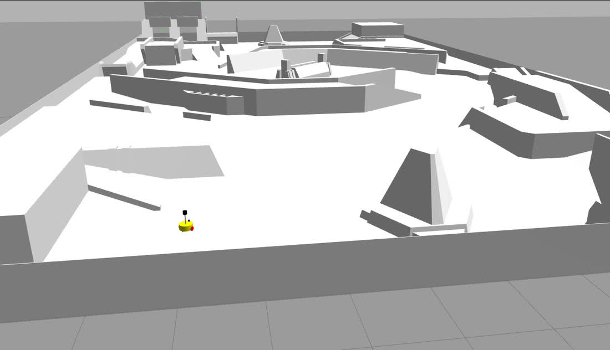

<div align="center">

# ROS 1 Racecar: SLAM and Autonomous Navigation

**A car-like robot that maps a track with lidar and drives itself through it in Gazebo and RViz.
One Docker command runs it on Linux, Windows or an Apple-silicon Mac.**




<sub>Left: Gazebo, looking straight down on the runway. Right: RViz riding along with the car:
lidar returns (red), local costmap, global plan (green), TEB's planned poses (small arrows) and
the car's recent poses (large arrows). 3× speed · <a href="docs/media/navigation.mp4">MP4</a></sub>

</div>

---

An Ackermann-steered racecar with a 2D lidar starts at one end of a runway lined with cones and
two diamond-shaped junctions, and is given a single goal at the far end. `move_base` plans a
route on an occupancy map, the TEB local planner bends it into a trajectory the car can
actually follow with its limited steering angle, and a pure-pursuit controller turns that into
speed and steering commands. Nobody touches the car after the goal is set. The same drive can
run with gmapping, which builds the map from scratch out of nothing but the lidar scans.

This is my ROS 1 workspace from 2022, rebuilt for ROS Noetic and packaged so that anyone can
run it without installing ROS.

<table>
<tr>
<td align="center" width="33%"><h2>23 m</h2>down the runway to a single goal, past 8 cones and two junctions, with no human input</td>
<td align="center" width="33%"><h2>0.24 m</h2>from the goal where the car comes to rest. CI repeats the whole drive on every push</td>
<td align="center" width="33%"><h2>1 command</h2>opens the full simulation in your browser. No ROS install, no Linux machine</td>
</tr>
</table>

## Mapping the track from scratch



<sub>Left: ground truth in Gazebo. Right: the map gmapping builds from the lidar while the car
drives (black: walls and cones, green: the current scan, red arrows: where the car has been).
3× speed · <a href="docs/media/mapping.mp4">MP4</a></sub>

gmapping is a Rao-Blackwellized particle filter. Each particle carries its own guess of the
car's trajectory and its own occupancy grid, and scan matching against that grid keeps the
guesses tight. The map on the right starts empty and fills in only where the lidar can see:
the car's own lane, the cones in it and the junction walls. The divider hides the other lane.

## How the car drives



| Layer | Packages | What it does |
|---|---|---|
| Simulation | `racecar_description`, `racecar_gazebo` | URDF/xacro car with lidar and camera, the runway world, saved maps |
| Mapping | `gmapping` | occupancy grid from lidar scans |
| Planning | `move_base`, `global_planner`, `teb_local_planner` | global route on the map; local trajectory optimised for a car-like robot with a minimum turning radius |
| Control | `path_pursuit.py` | pure pursuit: picks a look-ahead point on the plan and steers toward it, slowing down in tight turns and near the goal |
| Actuation | `ackermann_cmd_mux`, `racecar_control` | priority mux between teleop and navigation; `ros_control` controllers for the four wheels and two steering hinges |

## Quick start

### Docker (any OS, including Apple silicon)

```bash
git clone https://github.com/InvalidCodes/2022ROS1.git && cd 2022ROS1
docker build -t ros1-racecar -f docker/Dockerfile .      # about 6 GB
```

Watch it live in the browser:

```bash
docker run --rm -p 6080:6080 ros1-racecar desktop.sh
```

Open <http://localhost:6080/vnc.html>, click **Connect**, and pick a target on the track with
RViz's **2D Nav Goal** tool. The car drives there, and turns around for the next goal if it has
to. A small `tk` window drives it by hand with W A S D.

Record the two demos above headlessly, or check that the car still reaches its goal (the same
check CI runs on every push):

```bash
docker run --rm -v "$PWD/out:/out" ros1-racecar record_demo.sh navigation
docker run --rm -v "$PWD/out:/out" ros1-racecar record_demo.sh mapping
docker run --rm ros1-racecar test_navigation.sh
```

On an Apple-silicon Mac the image runs natively on arm64 and Gazebo renders on the CPU. With
[Colima](https://github.com/abiosoft/colima) (6 CPUs, 12 GB) the simulation runs at about
0.9× real time.

### Native (Ubuntu 20.04 + ROS Noetic)

```bash
cd racecar_ws
rosdep install --from-paths src --ignore-src -r -y
catkin build && source devel/setup.bash

roslaunch racecar_gazebo racecar_runway_demo.launch      # navigation: click 2D Nav Goal
roslaunch racecar_gazebo racecar_runway_mapping.launch   # navigation + gmapping on /slam_map
roslaunch racecar_gazebo racecar_runway.launch           # drive it yourself (WASD window) ...
roslaunch racecar_gazebo slam_gmapping.launch            # ... and map as you go
```

## ROS 1 fundamentals

`ws_rviz` holds the exercises the racecar work grew out of: describing a robot in URDF and xacro,
giving it simulated sensors, and bringing a competition field into Gazebo.



<sub>The two-wheel car from `urdf02_gazebo` (lidar on the mast, camera in front) inside the RMUS
2023 field, exported from CAD to URDF and turned into a Gazebo world.
`roslaunch urdf02_gazebo demo02_car.launch`</sub>

## Repository layout

```
racecar_ws/                    the racecar simulation
  src/racecar/
    racecar_description/       URDF/xacro, meshes
    racecar_gazebo/            worlds, saved maps, launch files, navigation config, path_pursuit.py
    racecar_control/           ros_control config, teleop
    system/                    ackermann_cmd_mux, VESC and serial drivers, waypoint logger
ws_rviz/                       ROS 1 fundamentals
  src/
    urdf01_rviz/               first URDF robots in RViz: links, joints, xacro
    urdf02_gazebo/             a two-wheel car in xacro with camera, lidar and diff-drive plugins
    rmus_map/                  the RMUS 2023 competition field, converted from CAD to URDF and a Gazebo world
    nav-demo/                  gmapping and AMCL configurations for that car
docker/                        image, browser desktop, headless recording, end-to-end test
docs/media/                    the animations in this README
```

<details>
<summary><b>Porting notes: from a 2018-era Kinetic stack to Noetic on arm64</b></summary>

| Problem | Fix |
|---|---|
| `racecar_gazebo` did not configure: OpenCV was listed as a catkin component, with a hard-coded OpenCV 3 path from Kinetic and a misspelled `${OpenCV_LiBRARIES}` | find OpenCV as a system package |
| `findLine.cpp` includes `<opencv/highgui.h>`, which OpenCV 4 removed | `<opencv2/highgui.hpp>` |
| Python 2 nodes: mixed tabs and spaces, `print` statements, `Tkinter`, `python` shebangs | ported to Python 3 |
| Gazebo hung for minutes on start: the runway's 8 cones load from Gazebo's retired online model database | the image fetches `construction_cone` from the model repository and turns the database off |
| `slam_gmapping.launch` never produced a map: the simulation publishes the ground-truth pose as `map → base_link`, so there is no `odom` frame | gmapping uses `map` as its odometry frame and publishes its estimate as `slam_map → map` |
| `move_base` plans but the car does not move | `path_pursuit.py` turns the plan into Ackermann commands; the demo launch starts it |
| `path_pursuit.py` ignored every goal after the first | it drives again when a new goal arrives |
| RMUS world meshes pointed at `/home/...` on the original machine | `model://` URIs resolved through the package |
| ROS 1 has no macOS or arm64-Mac install | Docker image, Xvfb + software OpenGL for rendering, noVNC for interactive use |

</details>

## Acknowledgements and license

The racecar simulation under `racecar_ws/src/racecar` is adapted from the open-source
[MIT RACECAR](https://github.com/mit-racecar) stack and its community extensions (MuSHR
teleop, the Yujin Robot command mux, VESC and serial drivers). Those files keep their original
licenses. Everything else is MIT, see [LICENSE](LICENSE).

See also [2022ROS2](https://github.com/InvalidCodes/2022ROS2), the ROS 2 counterpart.
